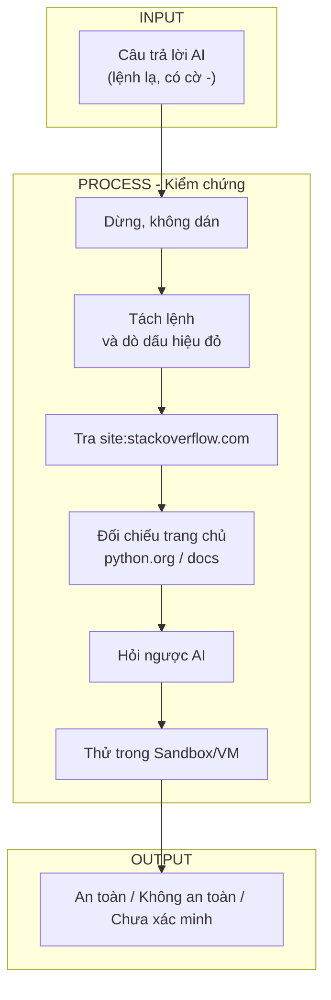

# Yêu cầu đầu ra:

> Sơ đồ IPO


> Prompt AI


```text
Bạn vừa đưa tôi lệnh sau để sửa lỗi "Path not found" khi cài Python:
Môi trường: Windows 11, Python 3.14.8.
Tôi CHƯA chạy lệnh. Trả lời ngắn gọn từng mục:
 
1. Từng thành phần của lệnh làm gì?
2. Lệnh thay đổi chính xác gì trên máy (file, Registry, biến môi trường, quyền)? Có cần admin/sudo không, vì sao?
3. Có xóa, ghi đè hoặc tải dữ liệu từ Internet không? Từ đâu?
4. Lệnh có tồn tại thật và đúng cho OS của tôi không? Nếu không chắc, hãy nói "Tôi không chắc".
5. Mức rủi ro (thấp/trung bình/cao) và tình huống xấu nhất?
6. Cách hoàn tác?
7. Có cách an toàn hơn (như dùng giao diện) không?
8. Link tài liệu chính thức hoặc câu hỏi StackOverflow xác nhận. Nếu không có link thật, nói rõ, không bịa link.
```
